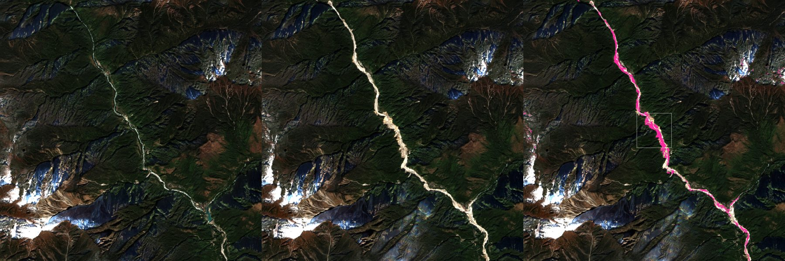

# Teesta glacial-lake outburst flood, Sikkim, 4 October 2023

A real Indian event, analysed with public satellite data only (AWS Open Data, no login). Every number below comes from
`demo/benchmark/event_teesta_2023_results.json`, written by:

```
python demo/event_teesta_2023.py --size-m 1600
```

## What the satellites saw

| Measure | Before (20 Nov 2022) | After (15 Nov 2023) | Change |
|---|---|---|---|
| South Lhonak lake area (open water, MNDWI > 0.3) | 1.358 km² | 1.28 km² | -0.078 km² (-5.7%) |
| Lake water near-infrared, median (silt makes it brighter) | 0.046 | 0.067 | ×1.5 |
| Water in the 12 km valley stretch | 1.006 km² | 0.977 km² | |

| Area | Clear pixels | Valley floor checked | Flood-affected ground |
|---|---|---|---|
| 12 km × 12 km of the Lachen Chu valley | 88.4% | 52.853 km² | **1.281 km²** |
| The DepthWizard scene (1.6 km square) | 98.2% | 2.087 km² | **0.328 km²** |



*Flood-affected* = within 600 m of the river channel, slope under 25°, clear in both images, and either vegetation lost
(NDVI fell by more than 0.25 to below 0.3: scoured or buried by debris) or new water (MNDWI > 0 now, not before).

## Data

| | |
|---|---|
| Pre-event scene | Maxar Open Data, event India-Floods-Oct-2023, `10300100CE8D0400-visual.tif`, 7 Mar 2022, 0.3 m, resampled to 0.5 m (CC BY-NC 4.0: demonstration only) |
| Before / after | Sentinel-2 L2A `S2B_45RXL_20221120_0_L2A` / `S2B_45RXL_20231115_0_L2A` (ESA Copernicus, Element 84 COGs), 10 m, same season, both under 2% cloud |
| Slope | Copernicus GLO-30 DEM |
| Outputs | `demo/reference/teesta_observed_2023.tif` (observed flood map for the app), `demo/samples/teesta_lachen_2022.tif` (the scene) |

## In the app

1. Start DepthWizard; it estimates heights for `teesta_lachen_2022` (the RS3DAda weights are needed once).
2. **Respond → Flood scenario** on, water from the scene edges; **Observed flood** → load `demo/reference/teesta_observed_2023.tif`
   → CSI of the scenario against what happened, **Fit the water level**.
3. **Validate → Fix tall objects → Meta canopy map**: the valley slopes are forest, the model's weakest class.
4. **Assess → People at risk** and **Situation report**.

**The lake:** its shoreline moved little, but its water became much more silt-laden. The outburst lowered the lake
(it emptied through the breached moraine) more than it shrank its outline, so area alone understates the water
released; the volume needs a before/after elevation model of the lake basin.

## Caveats

- The flood happened in October, under monsoon cloud; the first clear pair is a month later, so the map shows what the
  flood left (scoured banks, debris, new channels), not the peak water.
- Vegetation loss also comes from landslides and road works; the 600 m channel buffer and slope limit keep most of the
  map on the valley floor, not all of it.
- The pre-event Maxar image is from March 2022: buildings built since are missing from the scene.
- 10 m pixels: narrow channels and single buildings are below the resolution; use it for areas, not for one house.
