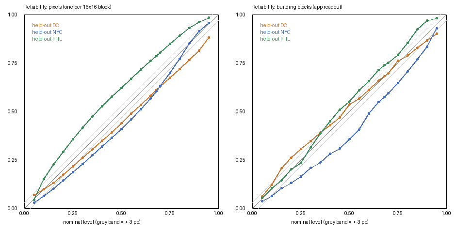

# Calibrated uncertainty: split-conformal intervals on GAMUS (plan step 4)

Commands (from `SynRS3D/`):

```
/usr/bin/lockf -k -t 14400 <scratchpad>/model.lock .venv/bin/python demo/uncertainty_calibration.py --predict   # model, once
.venv/bin/python demo/uncertainty_calibration.py          # this report + calibration/conformal.json, from the cache
.venv/bin/python demo/uncertainty_calibration.py --selftest
```

**Data.** GAMUS test split, 150 frozen tiles (demo/gamus_v2.py, data/GAMUS_bench.txt): Washington DC, New York, Philadelphia; 0.33 m aerial orthophotos; LiDAR nDSM reference; 504x504 centre crop; 4-flip TTA fp16 MPS. Pixels: one random pixel per 16x16 block per tile (153,285 samples, voids excluded). Buildings: the app's own blocks (`app.extract_buildings` on predicted height, spread and land cover; 959 blocks with >= 20 LiDAR px: DC 409, NYC 221, PHL 329).

**Method.** Normalised split-conformal, score |ref - pred| / (spread + c), spread = 4-flip std. q = the ceil((n+1)(1-alpha))-th smallest calibration score. Leave-one-city-out: c and q from two cities, coverage on the third. c chosen on the calibration cities only (q on even tiles, smallest mean 90% width on odd tiles) from [0.1, 0.25, 0.5, 1.0, 2.0, 4.0, 8.0, 16.0]. Mondrian groups use only inference-time quantities: predicted land-cover group (buildings / trees / water / other) x predicted height bin; groups with < 200 (pixels) or < 40 (blocks) calibration samples use the pooled q. Coverage = share of held-out samples inside the interval (pooled), with the per-tile mean [95% bootstrap CI over tiles] beside it. Width = mean interval width after clipping the lower end at 0 m.

## Findings

- **Target missed.** 90% intervals on the held-out city cover pixels DC 81.4%, NYC 91.3%, PHL 96.1% (largest gap 8.6 pp) and building blocks DC 86.6%, NYC 83.3%, PHL 97.0% (largest gap 7.0 pp), not within ±3 pp. Coverage moves with the city: DC (leaf-off trees, taller buildings) is under-covered, PHL over-covered. The split-conformal guarantee needs exchangeable data (in theory: same city; not tested here); across cities it does not hold, so an interval calibrated on three US cities is only approximately 90% elsewhere.
- **Tall blocks are badly under-covered** (90% block interval, held-out city, by LiDAR height bin: DC 0-3 m 86% (n 14), 3-10 m 100% (n 272), 10-20 m 67% (n 101), 20-inf m 14% (n 22); NYC 0-3 m 100% (n 5), 3-10 m 99% (n 149), 10-20 m 49% (n 57), 20-inf m 30% (n 10); PHL 0-3 m 100% (n 10), 3-10 m 100% (n 218), 10-20 m 96% (n 93), 20-inf m 25% (n 8)). The per-city figure is carried by 3-10 m blocks; blocks with LiDAR height above 10 m, the ones that matter for flood and evacuation use, are often taller than the whole interval. The viewer says so next to the interval. In practice the interval is close to a constant ±6 m, clipped at 0 m, so for low-rise blocks it says little (e.g. a 4.9 m block gets 0.0-11.5 m).
- **The flip spread adds nothing as a normaliser.** c is chosen at the top of the grid (4.0, 8.0, 8.0 for pixels), i.e. spread + c is almost constant, and constant-width Mondrian intervals have the same coverage and width (mean 90% width 11.55 m vs 11.52 m). The width comes from the predicted class and height bin, not from the spread (block spread vs |error| Spearman 0.00).
- **Intervals are wide**: mean 90% width 11.5 m per pixel and 12.7 m per block, because tall objects are under-estimated and the groups cannot see which ones (coverage for blocks whose LiDAR height is above 20 m is far below 90%, section 2).
- **Shipped anyway, labelled honestly**: the block interval is the best-calibrated statement available; the flip spread map is relabelled 'consistency score'.
- **India (ICESat-2 roof photons in OSM footprints)**: the 90% block interval covers 71% of 96 buildings: under-coverage, as expected under the domain shift.

## 1. Pixels: held-out coverage (target: within ±3 pp of nominal)

| Variant | Held-out city | c | 68%: coverage (tile mean [CI]) | width (m) | 90%: coverage (tile mean [CI]) | width (m) | 95%: coverage (tile mean [CI]) | width (m) |
|---|---|---|---|---|---|---|---|---|
| mondrian_normalised | DC | 4.00 | 61.2 (61.1 [55.9, 65.7]) | 6.71 | 81.4 (81.2 [76.1, 85.8]) | 11.09 | 88.2 (88.0 [83.3, 92.0]) | 14.45 |
| mondrian_normalised | NYC | 8.00 | 60.4 (60.4 [54.7, 65.7]) | 6.16 | 91.3 (91.3 [89.0, 93.5]) | 12.91 | 95.7 (95.7 [94.4, 96.9]) | 16.77 |
| mondrian_normalised | PHL | 8.00 | 78.6 (78.6 [76.3, 80.9]) | 5.19 | 96.1 (96.1 [94.9, 97.3]) | 10.57 | 98.4 (98.4 [97.4, 99.2]) | 14.76 |
| pooled_normalised | DC | 0.50 | 58.2 (58.1 [52.1, 64.0]) | 3.91 | 83.1 (82.9 [76.3, 88.8]) | 13.63 | 91.3 (91.1 [85.2, 96.0]) | 21.33 |
| pooled_normalised | NYC | 1.00 | 58.5 (58.5 [50.8, 66.3]) | 3.55 | 80.1 (80.1 [72.7, 87.0]) | 11.12 | 89.5 (89.5 [84.3, 94.5]) | 17.50 |
| pooled_normalised | PHL | 1.00 | 90.3 (90.3 [88.1, 92.4]) | 6.24 | 99.3 (99.3 [98.6, 99.8]) | 19.28 | 99.6 (99.6 [99.1, 100.0]) | 25.17 |
| mondrian_constant_width | DC | const | 60.9 (60.8 [55.7, 65.4]) | 6.83 | 80.9 (80.8 [75.7, 85.3]) | 11.15 | 87.7 (87.6 [82.8, 91.6]) | 14.33 |
| mondrian_constant_width | NYC | const | 60.6 (60.6 [55.0, 65.9]) | 6.22 | 91.6 (91.6 [89.5, 93.7]) | 13.00 | 95.9 (95.9 [94.7, 97.1]) | 16.85 |
| mondrian_constant_width | PHL | const | 78.7 (78.7 [76.3, 81.0]) | 5.13 | 95.9 (95.9 [94.4, 97.3]) | 10.52 | 98.1 (98.1 [96.9, 99.2]) | 14.83 |

Largest gap to nominal over the three held-out cities (pp), Mondrian normalised: 68% 10.6, 90% 8.6, 95% 6.8

### 90% interval by predicted class, Mondrian normalised

| Group | DC: n, coverage, width | NYC: n, coverage, width | PHL: n, coverage, width |
|---|---|---|---|
| agriculture | 52, 98.1%, 1.46 m | 126, 100.0%, 3.06 m | – |
| bareland | 741, 88.0%, 1.54 m | 2,063, 95.7%, 3.27 m | 432, 98.4%, 5.45 m |
| buildings | 11,189, 87.7%, 14.79 m | 11,742, 86.4%, 9.52 m | 18,928, 94.0%, 12.61 m |
| developed | 4,465, 87.1%, 1.71 m | 2,782, 94.0%, 3.30 m | 8,499, 98.3%, 5.58 m |
| rangeland | 12,607, 75.5%, 1.69 m | 11,304, 87.9%, 3.30 m | 7,605, 97.9%, 5.58 m |
| road | 6,153, 81.2%, 1.76 m | 2,595, 90.6%, 3.36 m | 8,274, 95.2%, 5.50 m |
| trees | 15,642, 79.8%, 22.86 m | 18,497, 95.4%, 26.23 m | 6,455, 99.8%, 25.42 m |
| water | 36, 50.0%, 0.80 m | 2,091, 93.9%, 0.91 m | 1,007, 88.0%, 0.71 m |

### 90% interval by predicted height bin, Mondrian normalised

| Group | DC: n, coverage, width | NYC: n, coverage, width | PHL: n, coverage, width |
|---|---|---|---|
| 0-3 m | 34,098, 79.3%, 6.43 m | 35,471, 93.3%, 11.34 m | 33,149, 96.6%, 7.03 m |
| 10-20 m | 2,207, 90.7%, 19.05 m | 1,484, 73.8%, 15.34 m | 2,229, 95.0%, 18.74 m |
| 20-inf m | 1,197, 95.7%, 51.41 m | 60, 100.0%, 40.80 m | 887, 69.0%, 47.08 m |
| 3-10 m | 13,383, 84.0%, 18.03 m | 14,185, 88.2%, 16.47 m | 14,935, 96.9%, 15.05 m |

### 90% interval by reference height bin (not available at inference: diagnostic), Mondrian normalised

| Group | DC: n, coverage, width | NYC: n, coverage, width | PHL: n, coverage, width |
|---|---|---|---|
| 0-3 m | 25,488, 95.3%, 4.25 m | 27,378, 99.1%, 7.64 m | 33,975, 98.9%, 7.77 m |
| 10-20 m | 8,775, 80.4%, 19.28 m | 9,379, 83.7%, 21.15 m | 3,005, 82.3%, 15.82 m |
| 20-inf m | 5,595, 32.9%, 25.54 m | 4,598, 67.7%, 23.57 m | 954, 58.0%, 39.23 m |
| 3-10 m | 11,027, 74.6%, 13.02 m | 9,845, 88.2%, 14.76 m | 13,266, 94.8%, 14.48 m |

### 90% interval by reference class (GAMUS LiDAR classes: diagnostic), Mondrian normalised

| Group | DC: n, coverage, width | NYC: n, coverage, width | PHL: n, coverage, width |
|---|---|---|---|
| ? | 56, 85.7%, 2.78 m | 6,524, 94.0%, 8.19 m | – |
| buildings | 10,137, 87.5%, 16.93 m | 7,155, 85.2%, 11.35 m | 12,714, 94.2%, 15.07 m |
| ground | 8,444, 98.2%, 2.77 m | 1,706, 99.3%, 3.78 m | 14,109, 97.7%, 6.46 m |
| low vegetation | 5,141, 92.1%, 6.21 m | 12,123, 99.3%, 5.92 m | 8,225, 98.5%, 8.63 m |
| road | 12,870, 87.6%, 5.79 m | 3,455, 99.1%, 8.29 m | 8,762, 94.7%, 5.94 m |
| trees | 14,204, 57.5%, 18.45 m | 18,316, 84.6%, 22.76 m | 6,446, 95.9%, 20.75 m |
| water | 33, 69.7%, 10.90 m | 1,921, 98.5%, 1.43 m | 944, 92.9%, 1.86 m |

## 2. Building blocks: held-out coverage

Reported height = block median of the prediction (the value the viewer shows); reference = 90th percentile of the LiDAR nDSM inside the block. `signed` uses separate lower / upper quantiles (alpha/2 each) of the signed normalised residual, so it can follow the known under-estimation.

| Variant | Held-out city | Blocks | c | 68%: coverage (tile mean [CI]) | width (m) | 90%: coverage (tile mean [CI]) | width (m) | 95%: coverage (tile mean [CI]) | width (m) |
|---|---|---|---|---|---|---|---|---|---|
| symmetric | DC | 409 | 8.00 | 68.2 (58.7 [49.6, 67.7]) | 7.20 | 86.6 (79.8 [70.8, 87.9]) | 12.06 | 90.2 (86.6 [79.2, 93.2]) | 14.78 |
| symmetric | NYC | 221 | 16.00 | 57.5 (49.1 [35.2, 63.3]) | 6.70 | 83.3 (81.1 [72.3, 89.1]) | 11.64 | 92.8 (91.5 [86.0, 96.4]) | 15.72 |
| symmetric | PHL | 329 | 8.00 | 73.9 (73.5 [64.3, 81.9]) | 7.47 | 97.0 (93.2 [87.3, 97.7]) | 14.33 | 98.2 (95.0 [89.3, 99.2]) | 18.27 |
| signed | DC | 409 | 4.00 | 60.1 (47.0 [37.4, 56.7]) | 5.66 | 80.4 (70.6 [61.6, 79.1]) | 9.98 | 88.8 (81.1 [72.9, 88.3]) | 14.34 |
| signed | NYC | 221 | 16.00 | 66.1 (51.5 [39.6, 63.3]) | 5.51 | 89.1 (82.8 [74.3, 90.5]) | 11.65 | 94.6 (89.9 [81.8, 96.4]) | 15.17 |
| signed | PHL | 329 | 16.00 | 68.7 (64.0 [55.0, 72.8]) | 6.02 | 93.6 (90.5 [83.8, 95.6]) | 13.35 | 97.3 (93.6 [87.3, 98.4]) | 17.47 |
| symmetric_constant_width | DC | 409 | const | 68.5 (57.7 [48.3, 66.7]) | 7.12 | 86.3 (78.7 [69.5, 86.9]) | 11.89 | 89.7 (85.4 [78.0, 92.0]) | 14.59 |
| symmetric_constant_width | NYC | 221 | const | 57.5 (48.7 [34.5, 63.1]) | 6.71 | 84.6 (82.4 [73.5, 90.5]) | 11.64 | 92.8 (91.5 [86.0, 96.4]) | 15.71 |
| symmetric_constant_width | PHL | 329 | const | 72.0 (72.0 [62.4, 80.7]) | 7.30 | 96.4 (91.8 [84.4, 97.4]) | 13.98 | 98.2 (95.0 [89.3, 99.2]) | 18.13 |
| symmetric_height_scaled (diagnostic) | DC | 409 | 16.00 | 68.9 (62.4 [53.2, 70.8]) | 7.52 | 88.0 (81.1 [72.5, 88.7]) | 13.08 | 91.7 (92.1 [87.7, 95.9]) | 15.75 |
| symmetric_height_scaled (diagnostic) | NYC | 221 | 16.00 | 56.1 (48.9 [35.3, 62.8]) | 6.67 | 83.7 (79.2 [69.0, 88.2]) | 11.95 | 94.1 (91.4 [85.5, 96.3]) | 15.60 |
| symmetric_height_scaled (diagnostic) | PHL | 329 | 16.00 | 75.1 (76.1 [68.1, 83.5]) | 7.80 | 97.3 (93.7 [87.7, 98.2]) | 14.63 | 98.8 (98.1 [95.5, 99.8]) | 18.57 |

Shipped building variant: **symmetric** (rule: `signed` only if its 90% coverage is within ±3 pp in all three held-out cities and its mean width is smaller than `symmetric`). Largest gap (pp): 68% 10.5, 90% 7.0, 95% 4.8

### Blocks, 90% interval by predicted height bin

| Group | DC: n, coverage, width | NYC: n, coverage, width | PHL: n, coverage, width |
|---|---|---|---|
| 0-3 m | 8, 100.0%, 9.35 m | 3, 100.0%, 9.36 m | 4, 100.0%, 10.82 m |
| 10-20 m | 42, 83.3%, 14.66 m | 11, 90.9%, 20.80 m | 18, 94.4%, 20.95 m |
| 20-inf m | 9, 44.4%, 16.82 m | – | 5, 40.0%, 22.39 m |
| 3-10 m | 350, 87.7%, 11.69 m | 207, 82.6%, 11.18 m | 302, 98.0%, 13.84 m |

### Blocks, 90% interval by reference height bin

| Group | DC: n, coverage, width | NYC: n, coverage, width | PHL: n, coverage, width |
|---|---|---|---|
| 0-3 m | 14, 85.7%, 10.60 m | 5, 100.0%, 9.86 m | 10, 100.0%, 11.58 m |
| 10-20 m | 101, 67.3%, 12.53 m | 57, 49.1%, 12.25 m | 93, 95.7%, 15.32 m |
| 20-inf m | 22, 13.6%, 14.80 m | 10, 30.0%, 15.38 m | 8, 25.0%, 20.22 m |
| 3-10 m | 272, 99.6%, 11.74 m | 149, 99.3%, 11.21 m | 218, 100.0%, 13.81 m |

Block height accuracy against the reference (all 150 tiles, mean over tiles [CI] (pooled)): block median MAE 4.01 [3.46, 4.67] (3.37) m, bias -2.74 [-3.50, -2.00] (-2.60) m; block 90th pct MAE 3.62 [3.13, 4.16] (2.96) m, bias -0.72 [-1.44, 0.02] (-1.13) m. Spearman block spread vs |error|: 0.00.

## 3. Reliability plot



Empirical vs nominal coverage on each held-out city (pixels: Mondrian normalised; blocks: shipped variant).

## 4. Shipped

`SynRS3D/calibration/conformal.json`: c, [q_lo, q_hi] per group and level for blocks and pixels, refitted on all 150 tiles, with the held-out coverage above as provenance. The viewer shows the block's 90% interval labelled '90% interval (calibrated on GAMUS, US cities)'. The per-pixel map stays the flip spread, relabelled 'consistency score'; the per-pixel table is shipped for reference only.

## 5. Limits

- Calibrated on US aerial orthophotos at 0.33 m (DC, NYC, PHL). Coverage elsewhere (Indian 0.5 m satellite imagery, other building stock) is not guaranteed: conformal coverage holds only for data exchangeable with the calibration set, and the city-to-city gaps above show how far it moves under a modest shift.
- GAMUS DC and NYC imagery is mostly leaf-off (gamus_v2.md), so tree intervals reflect leaf-off conditions.
- India (building blocks only; from demo/recalibration.py, ICESat-2 roof photons inside OSM footprints, footprint median and median spread as block values; reference = median roof photon minus ground, not the LiDAR 90th percentile inside an app block used on GAMUS, so the two coverages are not strictly comparable): 68% interval covers 46% of 96 buildings (mean over 8 scenes 38%); 90% interval covers 71% of 96 buildings (mean over 8 scenes 57%); 95% interval covers 84% of 96 buildings (mean over 8 scenes 82%). Under-coverage: the GAMUS calibration does not transfer to Indian 0.5 m imagery without loss.
- Per-pixel intervals are not tested in India: the Indian laser references (ICESat-2 segments, GEDI rh98) are footprint-scale top heights, not pixel heights.
